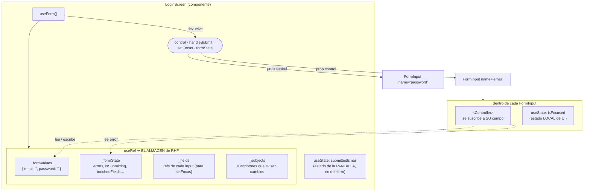
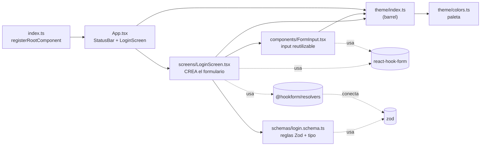
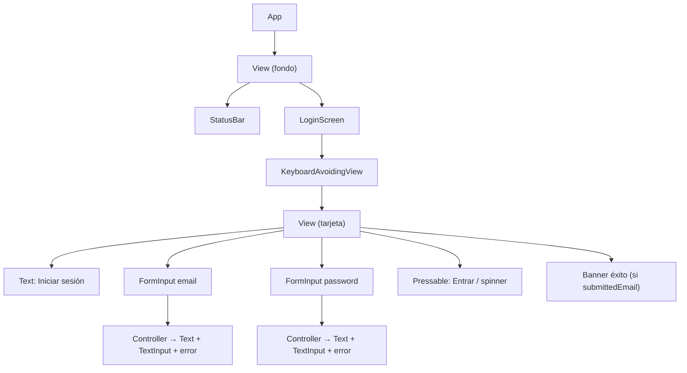
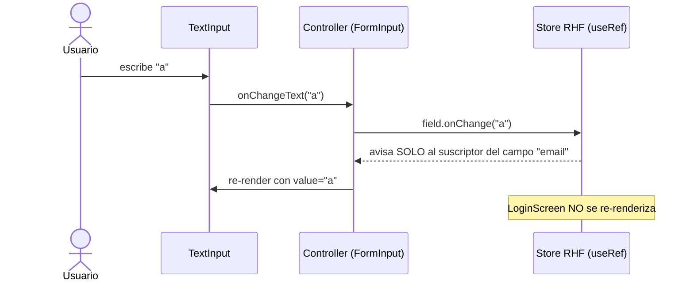
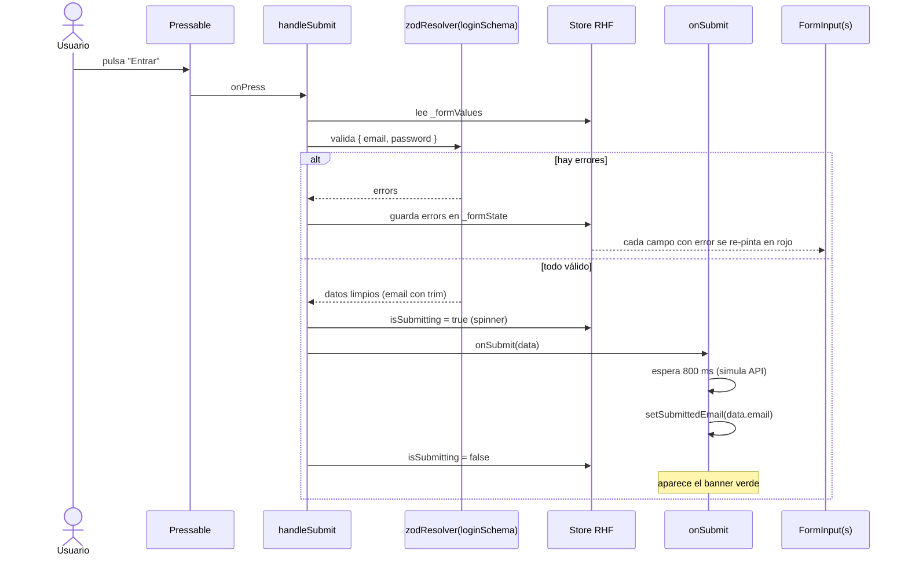

# Arquitectura del proyecto Login

Diagramas para entender **dónde vive cada cosa** y **cómo viajan los datos**.
Complementa a [CONCEPTOS.md](CONCEPTOS.md), que explica la teoría.

> Los diagramas usan **Mermaid**. Se ven en GitHub directamente; en VS Code
> instala la extensión *Markdown Preview Mermaid Support* y abre la vista
> previa (`Ctrl+Shift+V`).

---

## 1. ¿Dónde vive el almacén (store)?

**Respuesta corta:** dentro de `LoginScreen`, en la memoria del componente.

- `useForm()` ([LoginScreen.tsx](src/screens/LoginScreen.tsx)) crea el store la
  primera vez que se renderiza la pantalla y lo guarda en un `useRef` interno
  (en el código de RHF: `const _formControl = React.useRef(...)`).
- Un `useRef` sobrevive a los re-renders, pero **no** dispara re-renders al
  cambiar. Por eso escribir en un input no vuelve a pintar toda la pantalla.
- **No es global** (no es Redux, ni Context, ni Zustand): si desmontas
  `LoginScreen`, el store desaparece.
- **No se persiste**: al cerrar la app los datos se pierden (no hay
  AsyncStorage ni SecureStore).
- La única forma de llegar al store desde fuera es el objeto **`control`**,
  que `LoginScreen` pasa por props a cada `FormInput`.

### Tres tipos de estado, tres lugares distintos

| Estado | Dónde vive | Quién lo usa | Por qué ahí |
|---|---|---|---|
| Valores y errores del formulario | Store de RHF (`useRef` en `useForm`) | `Controller` de cada `FormInput` | Lo comparten varios campos y la validación |
| `submittedEmail` (banner verde) | `useState` en `LoginScreen` | Solo `LoginScreen` | Es resultado del envío, no un campo |
| `isFocused` (borde azul) | `useState` en `FormInput` | Solo ese input | Es pura apariencia; RHF no lo necesita |

---

## 2. Mapa de archivos e imports

---

## 3. Árbol de componentes en pantalla

---

## 4. Qué pasa cuando el usuario escribe

---

## 5. Qué pasa al pulsar "Entrar"

---

## 6. Resumen en una frase

> `useForm()` guarda el formulario en un **ref privado de `LoginScreen`**;
> `control` es la llave que se reparte a cada `FormInput`; cada `Controller`
> solo escucha **su** campo; y Zod decide qué es válido cuando se pulsa
> **Entrar**.
