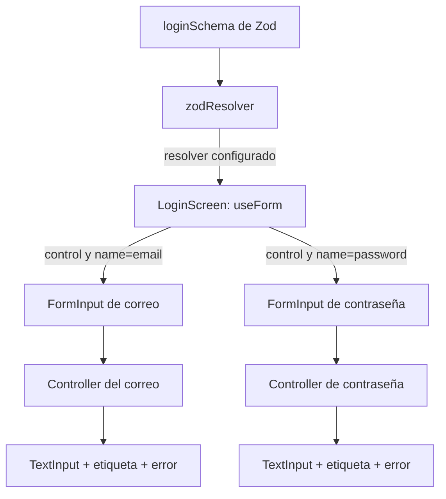
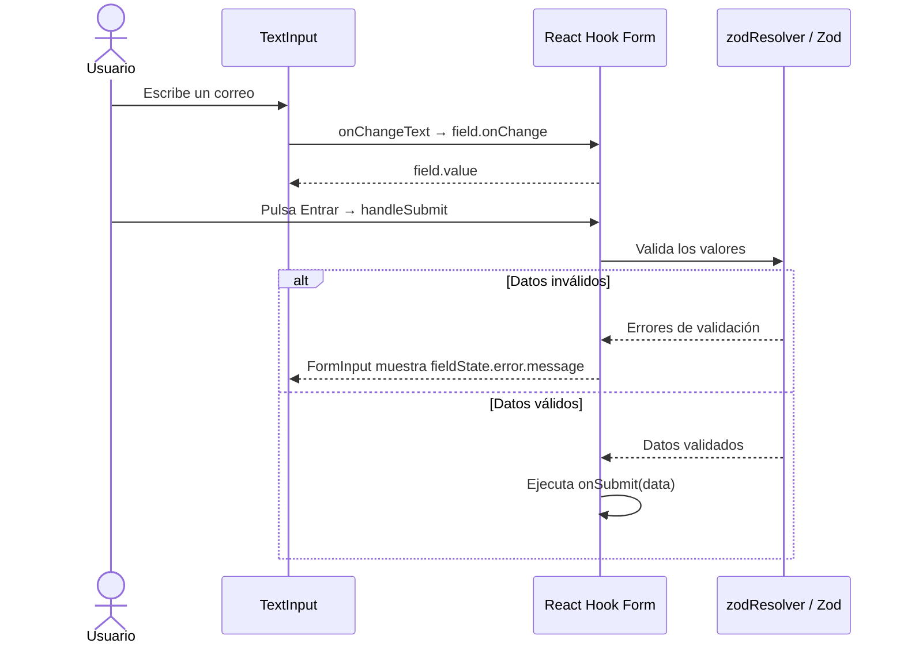

# ¿Para qué sirve FormInput.tsx?

**No necesitas crear un `FormInput` cada vez que uses Zod y React Hook Form.** Es un componente propio de este proyecto, opcional y útil para reutilizar la conexión de un campo con el formulario y su apariencia.

En este login recomiendo conservarlo: correo y contraseña comparten etiqueta, estilos, borde de foco y presentación de errores. Para un formulario pequeño que solo usarás una vez, también puedes escribir `Controller` directamente en la pantalla.

## 1. Cada pieza tiene una responsabilidad

| Pieza | Responsabilidad en este proyecto | Archivo |
| --- | --- | --- |
| Zod | Define reglas y transforma datos, como quitar espacios del correo. | [login.schema.ts](src/schemas/login.schema.ts) |
| `zodResolver` | Adapta la validación de Zod al formato que espera React Hook Form. | [LoginScreen.tsx](src/screens/LoginScreen.tsx) |
| React Hook Form (RHF) | Gestiona valores, errores, estado y envío del formulario. | [LoginScreen.tsx](src/screens/LoginScreen.tsx) |
| `Controller` | Conecta el valor y los eventos del input con RHF. | Dentro de `FormInput` |
| `TextInput` | Muestra el campo nativo donde escribes. | Dentro de `FormInput` |
| `FormInput` | Reúne conexión, etiqueta, estilos y mensaje de error. | [FormInput.tsx](src/components/FormInput.tsx) |

`FormInput` no importa Zod. Recibe el error desde RHF, por lo que podría seguir funcionando si cambias el validador. La integración con Zod ocurre mediante `resolver: zodResolver(loginSchema)` en la pantalla. Consulta la [integración oficial del resolver](https://github.com/react-hook-form/resolvers#zod).

## 2. Gráfico de la estructura



Si tu visor Markdown no muestra Mermaid, esta es la misma estructura en texto:

```text
LoginScreen → crea un formulario con useForm
  ├─ FormInput email    → Controller → TextInput
  └─ FormInput password → Controller → TextInput

loginSchema → zodResolver → validación del formulario
```

Los dos campos pertenecen al mismo formulario. `FormInput` no ejecuta otro `useForm` ni crea un formulario independiente.

## 3. ¿Qué pasa cuando escribes y envías?



En este proyecto no se configura `mode`, por lo que la validación inicial ocurre al enviar. Después de un envío con errores, el comportamiento predeterminado de RHF permite revalidar los campos al cambiar. Escribir un carácter no significa que siempre se ejecute Zod: depende de la configuración de validación.

El esquema aplica `.trim()` al correo. El dato que llega a `onSubmit` puede estar transformado; eso no implica que el texto visible se reescriba automáticamente. Zod distingue entre datos de entrada y de salida cuando hay transformaciones: [documentación de Zod](https://zod.dev/basics).

## 4. Cómo leer el componente actual

| Elemento | Para qué sirve |
| --- | --- |
| `control` | Permite a `Controller` conectarse al formulario creado en la pantalla. |
| `name` | Identifica el campo, como `email` o `password`. |
| `label` | Texto visible encima del input. |
| `field.value` | Valor que RHF proporciona al input. |
| `field.onChange` | Recibe el texto nuevo y lo comunica a RHF. |
| `field.onBlur` | Notifica que se salió del campo; participa en el estado touched y la validación según el modo. |
| `field.ref` | Permite gestionar el foco, por ejemplo con `setFocus('password')`. |
| `fieldState.error` | Error del campo que se presenta debajo del input. |
| `isFocused` | Estado visual local para pintar el borde de foco. |
| `...textInputProps` | Permite configurar teclado, contraseña, placeholder y otras opciones desde la pantalla. |

El genérico `TFieldValues` permite reutilizar el componente con distintas formas de formulario. `FieldPath<TFieldValues>` comprueba los nombres de los campos: escribir `emial` en vez de `email` produce un error de TypeScript.

`Omit<TextInputProps, 'value' | 'onChangeText'>` evita que el consumidor pase esas dos props: su control corresponde a RHF. Es una decisión del diseño de este componente.

## 5. ¿Cómo sería sin FormInput?

Puedes reemplazar un uso de `FormInput` por un `Controller` dentro del JSX de `LoginScreen`. Este fragmento usa el `control` que ya existe allí y requiere importar `Controller`, `TextInput`, `View` y `Text`:

```tsx
<Controller
  control={control}
  name="email"
  render={({ field, fieldState }) => (
    <View>
      <Text>Correo electrónico</Text>
      <TextInput
        ref={field.ref}
        value={field.value}
        onChangeText={field.onChange}
        onBlur={field.onBlur}
        keyboardType="email-address"
        autoCapitalize="none"
      />
      {fieldState.error?.message ? (
        <Text>{fieldState.error.message}</Text>
      ) : null}
    </View>
  )}
/>
```

El formulario seguirá funcionando con el mismo resolver y esquema. Este ejemplo omite los estilos y el estado visual de foco del componente actual; tendrías que añadirlos si quieres conservar esa presentación.

Al extraer esa estructura a `FormInput`, la pantalla puede expresar el campo con menos repetición:

```tsx
<FormInput
  control={control}
  name="email"
  label="Correo electrónico"
  keyboardType="email-address"
  autoCapitalize="none"
/>
```

`Controller` es una forma habitual de integrar campos controlados de React Native. También existe `useController`, que permite hacer la conexión mediante un hook. Ninguna de esas opciones exige crear un archivo llamado `FormInput`. Véase el [código y ejemplo oficial de Controller](https://github.com/react-hook-form/react-hook-form/blob/master/src/controller.tsx).

## 6. ¿Cuándo conviene extraerlo?

| Situación | Decisión razonable |
| --- | --- |
| Un campo aislado o un prototipo | `Controller` dentro de la pantalla puede bastar. |
| Varios inputs de texto con el mismo diseño | Extraer `FormInput` reduce repetición. |
| Login, registro y perfil comparten campos | Reutilizar `FormInput` facilita mantener una apariencia consistente. |
| Selector, interruptor o fecha | Crear una integración adecuada al tipo de valor y sus eventos. |
| Biblioteca de UI ya integrada con RHF | Evaluar su integración antes de crear otra capa. |

También puedes separar un input puramente visual de otro componente que lo conecte con RHF. Eso es útil si necesitas reutilizar la misma UI fuera de formularios gestionados por esta biblioteca, pero no es obligatorio para este login.

## 7. Matices del componente actual

- Aunque es genérico en los nombres del formulario, internamente usa un `TextInput`: conviene emplearlo con campos de texto. `FieldPath` no restringe por sí solo el valor a `string`. Un número, fecha o booleano necesita una adaptación específica.
- La contraseña se oculta porque `LoginScreen` pasa `secureTextEntry`; el nombre `password` no activa ese comportamiento automáticamente.
- La suscripción de `Controller` ayuda a limitar actualizaciones, pero no garantiza que solo se renderice un campo: el padre, las props y el estado que se observe también influyen.
- El estado de foco local tiene un propósito distinto del valor del formulario. No necesitas duplicar el texto con otro `useState`.

**Para este proyecto:** conserva `FormInput` como pieza reutilizable para inputs de texto. Aprende primero la conexión `value → onChangeText → RHF`; después, piensa en el componente como una forma de escribir esa conexión y su presentación una sola vez.

## Referencias

- [Implementación local de FormInput](src/components/FormInput.tsx).
- [Pantalla que crea el formulario](src/screens/LoginScreen.tsx).
- [Esquema local de validación](src/schemas/login.schema.ts).
- [React Hook Form: documentación de Controller](https://react-hook-form.com/docs/usecontroller/controller).
- [React Hook Form: configuración de useForm](https://react-hook-form.com/docs/useform).
- [Proyecto oficial: Controller](https://github.com/react-hook-form/react-hook-form/blob/master/src/controller.tsx).
- [Integración oficial con Zod](https://github.com/react-hook-form/resolvers#zod).
- [Zod: validación, tipos y transformaciones](https://zod.dev/basics).
- [Referencia de Expo SDK 57, versión usada en el proyecto](https://docs.expo.dev/versions/v57.0.0/).
